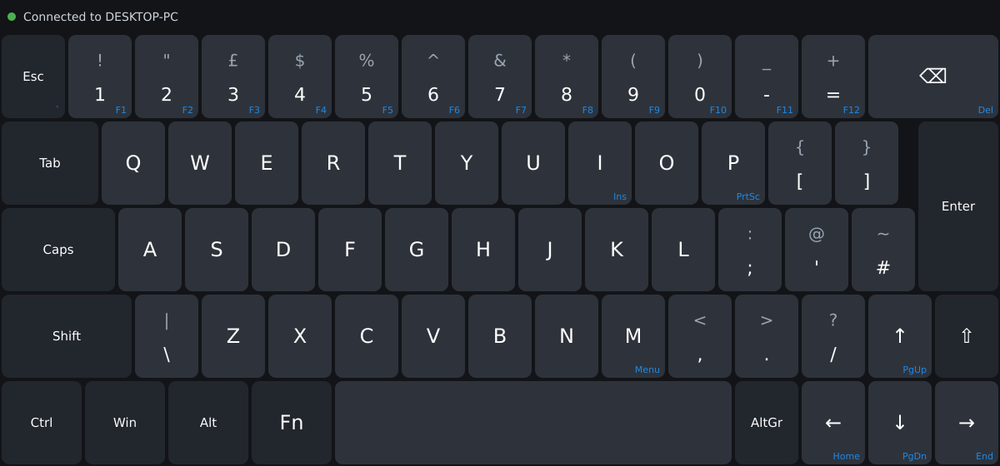
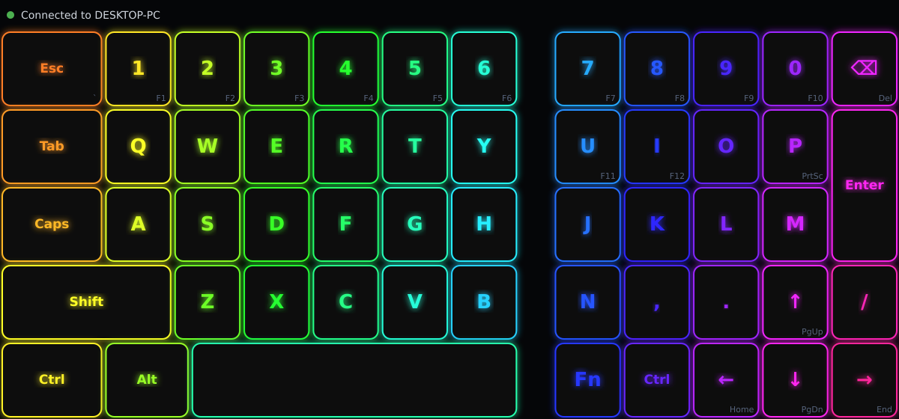

# BT Keyboard

A full-screen, landscape keyboard for Android that pairs with Windows as a **normal Bluetooth keyboard**. Nothing needs installing on the PC.

## Download
Get the latest APK: **[BTKeyboard.apk](https://github.com/wardy-uk1/BTKeyboard/releases/latest/download/BTKeyboard.apk)** (open this link on your phone and allow installs from your browser).

## What's new

### v1.5 (14 Nov 2026)
- New **controller mode** with three skins: Classic, Twin Stick and Neon RGB (Layout button). Two analog sticks, D-pad, A/B/X/Y, LB/RB, LT/RT, View, Menu and Home.
- Windows sees it as a standard game controller. Steam supports it in any game and can present it as an Xbox controller.
- **Re-pair needed once:** after updating, remove the phone in Windows Bluetooth settings and pair again so Windows picks up the controller.

### v1.4 (14 Nov 2026)
- New **Gaming (LED)** layout: big WASD block for your left hand, number keys 1–0, and U/I/O/P, J/K/L/M, N, Enter and arrows on the right.
- RGB key lighting with four effects: rainbow wave, static rainbow, reactive (keys light up when pressed) and solid cyan. Change it in ⚙ settings › Lighting.
- Slide between keys on the gaming layout: roll a finger from W to A without lifting.
- Fn on the gaming layout gives F1–F12 (number row, U and I), Del, PrtSc and Home/End/PgUp/PgDn.

### v1.3 (14 Nov 2026)
- Changed the Bluetooth connection settings to the standard "best effort" profile with room for bursts. The v1.1 settings could make some phones hold key presses back.
- Low-latency mode (keep-alive) is still available in ⚙ settings.

### v1.2 (14 Nov 2026)
- New **About** page (⚙ settings › About) with the version, quick help, what's new and licence.
- The in-app what's new is copied from this README at build time, so the two always match.

### v1.1 (14 Nov 2026)
- Fixed: keys could take a second or more to appear on the PC.
- The app now asks Bluetooth for a guaranteed low-latency link instead of best effort.
- New **Low-latency mode** (Settings, on by default) keeps the Bluetooth link awake while the keyboard is on screen, so keys don't wait for the radio to wake up. It switches itself off when you leave the app.

### v1.0 (14 Nov 2026)
- First release.
- Phone pairs with Windows as a standard Bluetooth keyboard; nothing to install on the PC.
- Full-screen landscape keyboard with four layouts: UK compact (default), UK full, US full, UK full + numpad.
- Fn layer on UK compact for F1–F12, Del, Home/End/PgUp/PgDn, Ins, PrtSc and Menu.
- Multi-touch typing, key repeat, and sticky modifiers (tap once for next key, double-tap to lock).
- Caps Lock indicator driven by the PC.
- Auto-reconnects to the last PC; PC button to pair, switch or disconnect.
- Vibration on key press (can be turned off) and optional click sound.

## Requirements
- Android 9 or newer, and a phone whose Bluetooth supports the *HID device* profile (most Pixel, Samsung and Xiaomi phones do; a few makers strip it out — the app tells you if so).
- Windows 10/11 with Bluetooth.

## Layouts (Layout button)
- **UK compact** (default): big keys, 5 rows. Hold or tap **Fn** for F1–F12 (number row), Del (Backspace), Home/End/PgUp/PgDn (arrows), Ins (I), PrtSc (P), Menu (M), ` (Esc).
- **UK full**: F-row, nav cluster, arrows.
- **US full**
- **UK full + numpad**
- **Gaming (LED)**: big keys for WASD games, RGB lighting and slide-between-keys.
- **Controller – Classic / Twin Stick / Neon RGB**: on-screen game controller.

Windows decides what each key types from its own keyboard-layout setting, so set Windows to **English (United Kingdom)** for the UK layouts (or US for the US one) and the legends will match.

## Modifiers
Shift, Ctrl, Alt, Win, AltGr and Fn work like a real keyboard when held with another finger. Tapped on their own:
- **one tap**: applies to the next key (blue outline)
- **two quick taps**: locked (solid blue); tap again to release

Holding any key auto-repeats (Windows does the repeat). Caps Lock shows a green dot when it's on.

## Pairing
1. Open the app, tap **PC › Pair a new PC…** and allow the phone to be visible.
2. On the PC: **Settings › Bluetooth & devices › Add device › Bluetooth**, choose your phone, confirm the code.
3. After that, the app reconnects to the last PC by itself when you open it. Tap **PC** to switch PCs or disconnect.

## Building
- **GitHub**: every push to `main` builds `BTKeyboard.apk` and publishes it as a release named after `versionName` in `app/build.gradle.kts`, using that version's notes from *What's new*.
- **Android Studio**: open the folder, then *Build › Build APK(s)*.

## Code map
- `HidKeyboard.kt`: Bluetooth HID registration, connection, reports, Caps Lock LED.
- `KeyEngine.kt`: pressed keys, sticky/locked modifiers, Fn layer.
- `KeyboardView.kt`: draws keys, multi-touch, haptics.
- `Layouts.kt`: all layouts and HID key codes. Add or edit layouts here.
- `MainActivity.kt`: full-screen UI, status bar, dialogs, permissions.

## Licence
GPL-3.0. See [LICENSE](LICENSE).

## Releasing a new version
1. Bump `versionCode` and `versionName` in `app/build.gradle.kts`.
2. Add a `### vX.Y (date)` entry at the top of *What's new*.
3. Push to `main`; the release and APK are created automatically.
